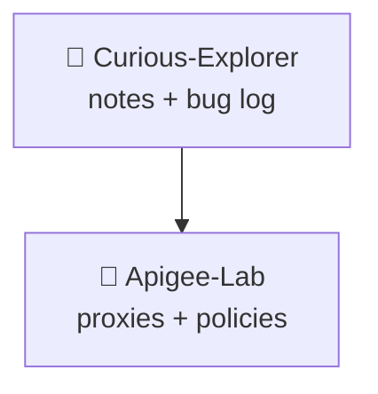

# 🌍 Curious-Explorer

## At a glance

A digital field journal: notes on APIs, gateways, security and debugging, written in plain words as I learn.


```bash
git clone https://github.com/SunnyJayaRaju/Curious-Explorer.git
cd Curious-Explorer
less concepts/what-is-a-proxy.md
```

---

## 📌 Table of Contents

- [At a glance](#at-a-glance)
- [👋 Welcome](#-welcome)
- [🎯 Purpose of this repository](#-purpose-of-this-repository)
- [Repository Structure](repository-structure)
- [📖 Suggested Learning Path](#-suggested-learning-path)
- [🗂️ Concept Index](#%EF%B8%8F-concept-index)
- [🐛 Bug Log](#-bug-log)
- [🔗 Related Repository](#-related-repository)
- [🛠️ Tools I'm Learning](#%EF%B8%8F-tools-im-learning)
- [🧡 A note to myself](#-a-note-to-myself)
- [🚀 Let's Explore](#-lets-explore)

---

## 👋 Welcome

**Curious-Explorer** is my personal space to track, understand and share what I'm learning in tech.
I'm building my foundation one step at a time and learning by doing.

---

## 🎯 Purpose of this repository

This repo acts as my **second brain**. Whenever I learn something, big or small, I write it down in simple words that make sense to me.

**Topics I explore here:**

- 🐙 **Git & GitHub:** branching strategies, PRs and commit hygiene.
- ☁️ **API management:** proxies, flows, policies and gateway logic.
- 🛡️ **Security:** OAuth 2.0 flows, JWT validation and mTLS.
- 💻 **CLI & scripting:** Bash tricks and automation.
- 📝 **Theory:** notes from courses, documentation and "Aha!" moments.

> **"If it helps me understand tech, it goes here."**

---

## Repository Structure

```text
Curious-Explorer/
├── README.md
├── concepts/
└── troubleshooting/
```

---

## 📖 Suggested Learning Path

If you're new to API engineering or Apigee, explore the repository in this order:

1. 🛡️ What is an API Proxy?
2. 🔑 OAuth 2.0 Simplified
3. 🛂 JWTs: The Passport of the Internet
4. ⚖️ JWT Access Tokens vs Opaque Access Tokens
5. 🚦 Spike Arrest vs Quota
6. 🔐 Key Value Maps (KVMs)
7. 📡 Service Callouts
8. 🧠 Flow Variables
9. 🤖 CI/CD: The Quality Gate Philosophy
10. 🐛 Troubleshooting Case Studies

This sequence builds from foundational API concepts to real-world debugging experiences.

---

## 📚 Concept Index

_Breakdowns of core engineering concepts using simple analogies._

| Domain               | Topic                                                             | The Analogy                          |
| :------------------- | :---------------------------------------------------------------- | :----------------------------------- |
| **🛡️ Fundamentals**  | **[What is an API Proxy?](./concepts/what-is-a-proxy.md)**        | The Waiter vs. The Kitchen.          |
| **🧠 Logic**         | **[Flow Variables](./concepts/flow-variables-explained.md)**      | Sticky notes for the request.        |
| **🛑 Traffic**       | **[Spike Arrest vs. Quota](./concepts/spike-arrest-vs-quota.md)** | The Bouncer vs. The Bartender.       |
| **🔑 Security**      | **[OAuth 2.0 Simplified](./concepts/oauth2-simplified.md)**       | The Hotel Key Card.                  |
| **🔐 Security**      | **[JWTs Explained](./concepts/jwt-explained.md)**                 | The Passport of the Internet.        |
| **🤫 Secrets**       | **[KVM (Key Value Maps)](./concepts/kvm-secrets.md)**             | The Bank Safety Deposit Box.         |
| **📡 Orchestration** | **[Service Callouts](./concepts/service-callout.md)**             | The Main Flow vs. The Side Quest.    |
| **🤖 Automation**    | **[The Quality Gate](./concepts/ci-cd-quality-gate.md)**          | Why we use robots to check our code. |

---

## 🐛 Bug Log

_Real-world errors I faced and exactly how I fixed them._

| Error Type        | Issue                                                                     | Solution                                   |
| :---------------- | :------------------------------------------------------------------------ | :----------------------------------------- |
| **☁️ Cloud DNS**  | **[Site Can't Be Reached](./troubleshooting/cloud-dns-error.md)**         | Handling `nip.io` load balancer hostnames. |
| **📦 Deployment** | **[Bundle Name Mismatch](./troubleshooting/bundle-name-mismatch.md)**     | XML name vs. filename strictness.          |
| **💥 Coding**     | **[Unexpected token <](./troubleshooting/json-parsing-xml.md)**           | Trying to parse XML as JSON.               |
| **⚙️ DevOps**     | **[Action Deprecation](./troubleshooting/github-actions-deprecation.md)** | Fixing outdated GitHub Action versions.    |

---

## 🔗 Related Repository

This repository is the theory. To see the practice, check out my lab:

### [🧪 Apigee-Lab](https://github.com/SunnyJayaRaju/Apigee-Lab)

My hands-on portfolio where I implement these concepts in real API proxies (JWT, caching, FaultRules).



---

## 🛠️ Tools I'm Learning


---

## 🧡 A note to myself

> _"Start where you are. Use what you have. Do what you can."_ (Arthur Ashe)

This repo is proof that you don't need to be an expert to start writing things down.
If you're new to tech too: welcome, you're in good company.
And to my future self: look how far you've come 👣.

---

## 🚀 Let's Explore

Thanks for stopping by. Let's keep learning, keep building and, most importantly, keep exploring 🌟.

[](https://github.com/SunnyJayaRaju)
